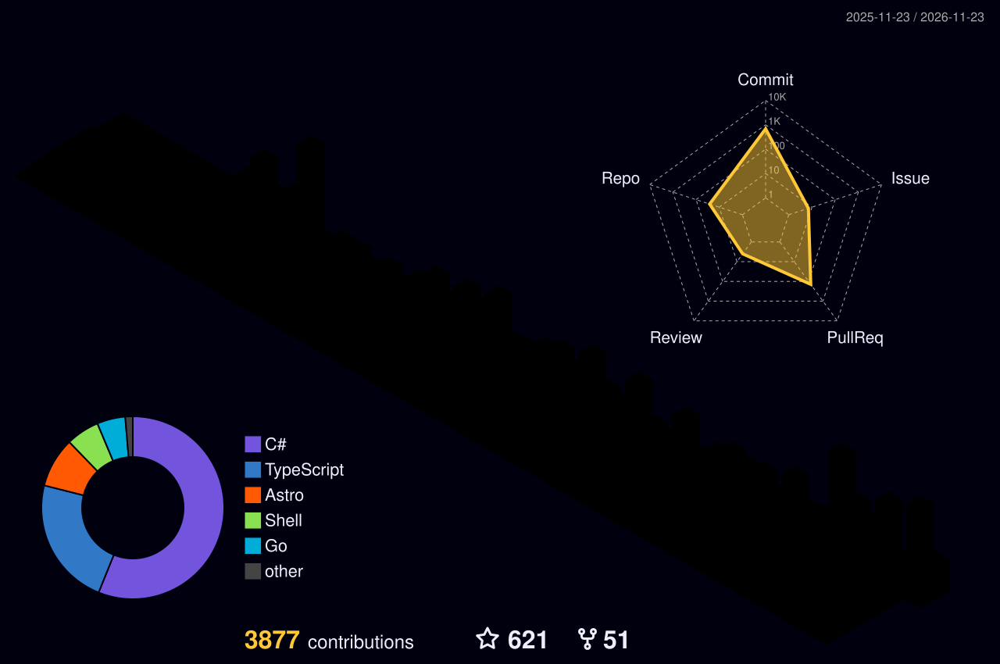
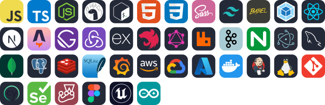

<h1>Hi 👋, I'm Vladimir</h1>

<h3>I'm a Node.js developer with a love for open-source and Linux. I am also author of the <a href="https://elevatech.xyz/" target="_blank">No.1 hiring platform</a>. Feel free to apply for a position, they are always hiring.</h3>


<h2>📪 Contact me</h2>
<p>
<a target="_blank" href="https://www.linkedin.com/in/vladdimir/">

</a>
</p>


[](https://github.com/utajum)


<!--START_SECTION:waka-->

**🐱 My GitHub Data** 

> 📦 8.7 GB Used in GitHub's Storage 
 > 
> 🏆 3,783 Contributions in the Year 2026
 > 
> 📜 120 Public Repositories 
 > 
> 🔑 47 Private Repositories 
 > 
**I'm an Early 🐤** 

```text
🌞 Morning                1299 commits        ████░░░░░░░░░░░░░░░░░░░░░   14.58 % 
🌆 Daytime                4285 commits        ████████████░░░░░░░░░░░░░   48.11 % 
🌃 Evening                2138 commits        ██████░░░░░░░░░░░░░░░░░░░   24.00 % 
🌙 Night                  1185 commits        ███░░░░░░░░░░░░░░░░░░░░░░   13.30 % 
```
📅 **I'm Most Productive on Tuesday** 

```text
Monday                   1519 commits        ████░░░░░░░░░░░░░░░░░░░░░   17.05 % 
Tuesday                  1705 commits        █████░░░░░░░░░░░░░░░░░░░░   19.14 % 
Wednesday                1583 commits        ████░░░░░░░░░░░░░░░░░░░░░   17.77 % 
Thursday                 1657 commits        █████░░░░░░░░░░░░░░░░░░░░   18.60 % 
Friday                   1079 commits        ███░░░░░░░░░░░░░░░░░░░░░░   12.11 % 
Saturday                 816 commits         ██░░░░░░░░░░░░░░░░░░░░░░░   09.16 % 
Sunday                   548 commits         ██░░░░░░░░░░░░░░░░░░░░░░░   06.15 % 
```


**I Mostly Code in TypeScript** 

```text
TypeScript               47 repos            ██████████░░░░░░░░░░░░░░░   39.83 % 
JavaScript               25 repos            █████░░░░░░░░░░░░░░░░░░░░   21.19 % 
Shell                    11 repos            ██░░░░░░░░░░░░░░░░░░░░░░░   09.32 % 
Astro                    9 repos             ██░░░░░░░░░░░░░░░░░░░░░░░   07.63 % 
Python                   5 repos             █░░░░░░░░░░░░░░░░░░░░░░░░   04.24 % 
C#                       4 repos             █░░░░░░░░░░░░░░░░░░░░░░░░   03.39 % 
HTML                     4 repos             █░░░░░░░░░░░░░░░░░░░░░░░░   03.39 % 
Java                     4 repos             █░░░░░░░░░░░░░░░░░░░░░░░░   03.39 % 
Go                       3 repos             █░░░░░░░░░░░░░░░░░░░░░░░░   02.54 % 
Blade                    1 repo              ░░░░░░░░░░░░░░░░░░░░░░░░░   00.85 % 
C                        1 repo              ░░░░░░░░░░░░░░░░░░░░░░░░░   00.85 % 
C++                      1 repo              ░░░░░░░░░░░░░░░░░░░░░░░░░   00.85 % 
Jinja                    1 repo              ░░░░░░░░░░░░░░░░░░░░░░░░░   00.85 % 
Kotlin                   1 repo              ░░░░░░░░░░░░░░░░░░░░░░░░░   00.85 % 
PHP                      1 repo              ░░░░░░░░░░░░░░░░░░░░░░░░░   00.85 % 
```


 Last Updated on 20/11/2026 11:00:47 UTC
<!--END_SECTION:waka-->




<h2>🛠 Skills</h2>

<p align="center">
  <a href="https://skillicons.dev">
    
  </a>
</p>

<p align="center">
  
  
  
  
  
  
</p>


