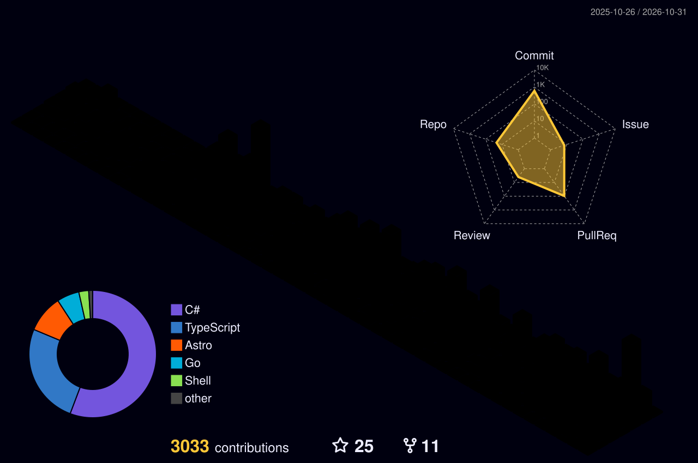
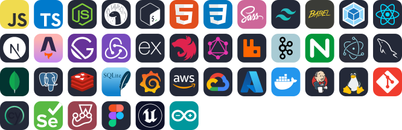

<h1>Hi 👋, I'm Vladimir</h1>

<h3>I'm a Node.js developer with a love for open-source and Linux. I am also author of the <a href="https://elevatech.xyz/" target="_blank">No.1 hiring platform</a>. Feel free to apply for a position, they are always hiring.</h3>


<h2>📪 Contact me</h2>
<p>
<a target="_blank" href="https://www.linkedin.com/in/vladdimir/">

</a>
</p>


[](https://github.com/utajum)


<!--START_SECTION:waka-->

**🐱 My GitHub Data** 

> 📦 6.8 GB Used in GitHub's Storage 
 > 
> 🏆 3,485 Contributions in the Year 2026
 > 
> 📜 120 Public Repositories 
 > 
> 🔑 45 Private Repositories 
 > 
**I'm an Early 🐤** 

```text
🌞 Morning                1253 commits        ████░░░░░░░░░░░░░░░░░░░░░   14.47 % 
🌆 Daytime                4211 commits        ████████████░░░░░░░░░░░░░   48.64 % 
🌃 Evening                2083 commits        ██████░░░░░░░░░░░░░░░░░░░   24.06 % 
🌙 Night                  1110 commits        ███░░░░░░░░░░░░░░░░░░░░░░   12.82 % 
```
📅 **I'm Most Productive on Tuesday** 

```text
Monday                   1516 commits        ████░░░░░░░░░░░░░░░░░░░░░   17.51 % 
Tuesday                  1670 commits        █████░░░░░░░░░░░░░░░░░░░░   19.29 % 
Wednesday                1514 commits        ████░░░░░░░░░░░░░░░░░░░░░   17.49 % 
Thursday                 1634 commits        █████░░░░░░░░░░░░░░░░░░░░   18.87 % 
Friday                   1070 commits        ███░░░░░░░░░░░░░░░░░░░░░░   12.36 % 
Saturday                 780 commits         ██░░░░░░░░░░░░░░░░░░░░░░░   09.01 % 
Sunday                   473 commits         █░░░░░░░░░░░░░░░░░░░░░░░░   05.46 % 
```


**I Mostly Code in TypeScript** 

```text
TypeScript               47 repos            ██████████░░░░░░░░░░░░░░░   40.87 % 
JavaScript               25 repos            █████░░░░░░░░░░░░░░░░░░░░   21.74 % 
Shell                    10 repos            ██░░░░░░░░░░░░░░░░░░░░░░░   08.70 % 
Astro                    9 repos             ██░░░░░░░░░░░░░░░░░░░░░░░   07.83 % 
Python                   5 repos             █░░░░░░░░░░░░░░░░░░░░░░░░   04.35 % 
```


 Last Updated on 13/11/2026 09:04:05 UTC
<!--END_SECTION:waka-->




<h2>🛠 Skills</h2>

<p align="center">
  <a href="https://skillicons.dev">
    
  </a>
</p>

<p align="center">
  
  
  
  
  
  
</p>


